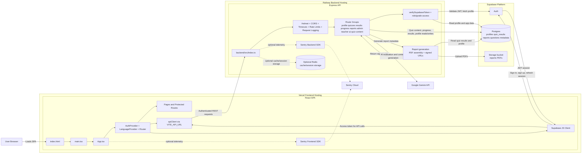
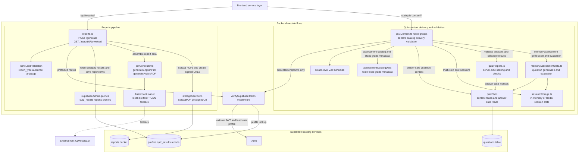

# System Architecture Diagram

This document captures the current system/container architecture for the holistic assessment tool based on the active frontend, backend, and deployment configuration.

## Scope

- System/container-level view
- Frontend hosting and runtime boundary
- Backend API and core responsibilities
- Supabase auth/database/storage boundaries
- External integrations used by the application

## Mermaid Script

## Backend Module-Level Flow Diagram

### Backend Module Notes

- `quizContent.ts` contains three backend patterns rather than one generic flow: static catalog/grade metadata responses, database-backed safe question delivery through `quizDb.ts`, and server-side validation or session-backed interactions through `quizHelpers.ts` and `sessionStorage.ts`.
- `quizDb.ts` is the content boundary for the `questions` table. It returns frontend-safe `content` fields for delivery endpoints and keeps `answer_data` reads in separate helpers used only by backend validation paths.
- `sessionStorage.ts` supports multi-step quiz flows such as spelling and memory assessment, using in-memory storage by default and Redis when configured.
- `reports.ts` orchestrates the report pipeline end to end: authenticated request validation, result aggregation from Supabase, PDF generation, storage upload, report record persistence, and signed URL generation.
- `pdfGenerator.ts` includes a separate Arabic rendering path with local-font loading and CDN fallback, which is why the report pipeline is worth showing as its own backend module flow.

## Boundary Notes

- The frontend is a Vite-built React SPA bootstrapped in `src/main.tsx` and composed in `src/App.tsx`.
- The frontend authenticates directly with Supabase using `src/supabase-client.ts` and stores sessions in `window.sessionStorage`.
- The frontend calls the backend through `src/services/apiClient.ts`, which injects the Supabase access token into `Authorization` headers and targets `VITE_API_URL`.
- The backend is an Express app in `backend/src/index.ts` deployed separately from the frontend.
- The backend exposes both `/api/v1/*` canonical routes and `/api/*` compatibility routes.
- The backend uses a Supabase service-role client in `backend/src/config/supabase.ts` for server-side database and storage access.
- Report generation is a distinct backend flow in `backend/src/routes/reports.ts`: fetch quiz results, generate English and Arabic PDFs, upload them to Supabase Storage, persist a report row, and return signed URLs.
- Gemini is called only from the backend API, not from the browser directly.
- Sentry and Redis are environment-dependent integrations and are shown as optional nodes.

## Primary Flows

1. Authentication
   Browser users sign in through the frontend Supabase client, which receives and refreshes JWT sessions via Supabase Auth.

2. API access
   The SPA attaches the current Supabase access token to REST calls made to the Express backend, which verifies the token and loads the user profile before protected work.

3. Quiz and progress data
   Backend route groups read and write quiz metadata, questions, profiles, results, progress, and report records in Supabase Postgres.

4. Report generation
   The backend report route aggregates quiz data, generates PDFs, uploads them to Supabase Storage, saves the report record, and returns signed download URLs to the frontend.

5. AI-backed features
   The frontend calls backend AI endpoints, and the backend mediates requests to Gemini.

## Assumptions

- The frontend is hosted on Vercel based on `vercel.json` SPA rewrites.
- The backend is hosted on Railway based on `backend/railway.json`.
- Supabase is the system of record for authentication, relational data, and generated report file storage.
- Redis and Sentry may not be enabled in every environment, so they are represented as optional integrations rather than required core infrastructure.