# Holistic Assessment Tool — Comprehensive Project Overview

> **A web-based platform for holistic student assessment across cognitive, oral, and academic skill domains.**
>
> Built with React + TypeScript (Vite) on the frontend, Node.js/Express on the backend, and Supabase (PostgreSQL + Auth) as the data layer.

---

## Table of Contents

1. [High-Level Architecture](#1-high-level-architecture)
2. [Technology Stack](#2-technology-stack)
3. [Repository Structure](#3-repository-structure)
4. [Frontend Architecture](#4-frontend-architecture)
5. [Backend Architecture](#5-backend-architecture)
6. [Database Schema](#6-database-schema)
7. [Authentication & Authorization](#7-authentication--authorization)
8. [Assessment Domains & Quiz Catalog](#8-assessment-domains--quiz-catalog)
9. [Key User Flows](#9-key-user-flows)
10. [Deployment Architecture](#10-deployment-architecture)
11. [Security Model](#11-security-model)
12. [Developer Perspective — Code Quality & Maintainability](#12-developer-perspective--code-quality--maintainability)
13. [Architect Perspective — Scalability & Patterns](#13-architect-perspective--scalability--patterns)
14. [Product Manager Perspective — Features & Roadmap](#14-product-manager-perspective--features--roadmap)
15. [Environment Variables](#15-environment-variables)
16. [Getting Started](#16-getting-started)
17. [Open Questions & Actionable Insights](#17-open-questions--actionable-insights)

---

## 1. High-Level Architecture

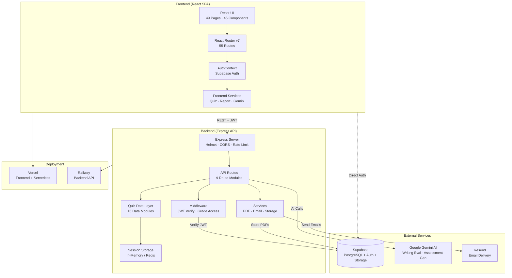

---

## 2. Technology Stack

| Layer | Technology | Purpose |
|-------|-----------|---------|
| **Frontend** | React 18, TypeScript, Vite 5 | SPA framework & build tooling |
| **Styling** | Tailwind CSS 3, DaisyUI 5 | Utility-first CSS + component library |
| **Animation** | Framer Motion | Page transitions & micro-interactions |
| **Drag & Drop** | @dnd-kit | Sortable quiz interactions |
| **PDF Generation** | @react-pdf/renderer (client), PDFKit (server) | Client-side reports & server-side reports |
| **Icons** | Lucide React | Consistent icon set |
| **Routing** | React Router DOM v7 | Client-side routing with lazy loading |
| **Backend** | Node.js 20+, Express 4 | REST API server |
| **Validation** | Zod | Runtime schema validation (backend) |
| **Auth** | Supabase Auth (JWT) | Authentication & session management |
| **Database** | Supabase (PostgreSQL) | Data persistence with RLS |
| **Storage** | Supabase Storage | PDF report file storage |
| **AI** | Google Gemini 2.5 Flash | Writing evaluation & assessment generation |
| **Email** | Resend API | Transactional email with PDF attachment |
| **Security** | Helmet, express-rate-limit | HTTP hardening & rate limiting |
| **Session** | In-Memory / Redis | Server-side quiz session tracking |
| **TTS** | Web Speech API | Text-to-speech for spelling & phonics quizzes |
| **Deploy** | Vercel (frontend), Railway (backend) | Production hosting |

---

## 3. Repository Structure

```
holistic-assessment-tool/
├── src/                        # Frontend source (React + TypeScript)
│   ├── App.tsx                 # Root component — 55 lazy-loaded routes
│   ├── main.tsx                # React entry point
│   ├── supabase-client.ts      # Supabase client + helper functions
│   ├── components/             # 45 reusable UI components
│   │   ├── auth/               # Auth-related components
│   │   ├── common/             # Shared UI primitives
│   │   ├── games/              # Game-specific components
│   │   ├── quiz/               # Quiz-specific components (GradeSelector, etc.)
│   │   └── reading/            # Reading assessment components
│   ├── contexts/               # React Context providers (AuthContext)
│   ├── data/                   # Frontend quiz data (12 data modules)
│   ├── hooks/                  # Custom React hooks
│   ├── pages/                  # 49 page-level components
│   ├── services/               # API client services (4 modules)
│   ├── types/                  # TypeScript type definitions
│   └── utils/                  # Utility functions (8 modules)
│
├── backend/                    # Backend API (Express + TypeScript)
│   ├── src/
│   │   ├── index.ts            # Express server entry point
│   │   ├── config/             # Supabase admin client config
│   │   ├── data/               # 16 quiz data modules (secure, server-side)
│   │   ├── lib/                # Session storage (Memory/Redis)
│   │   ├── middleware/         # Auth (JWT verify), grade access control
│   │   ├── routes/             # 9 API route modules
│   │   ├── services/           # Email, PDF generation, storage
│   │   └── types/              # Shared TypeScript types
│   └── scripts/                # DB schema, seed scripts
│
├── server/                     # Legacy email server (Nodemailer/Gmail)
├── api/                        # Vercel serverless function (send-report)
├── public/                     # Static assets (puzzle images)
├── supabase/                   # Supabase configuration
└── [config files]              # Vite, Tailwind, ESLint, TypeScript configs
```

---

## 4. Frontend Architecture

### 4.1 Routing & Code Splitting

All 49 page components are **lazy-loaded** via `React.lazy()` with a shared `<Suspense>` boundary showing a `<LoadingSpinner />`. Routes are wrapped in `<AnimatePresence>` for animated transitions.

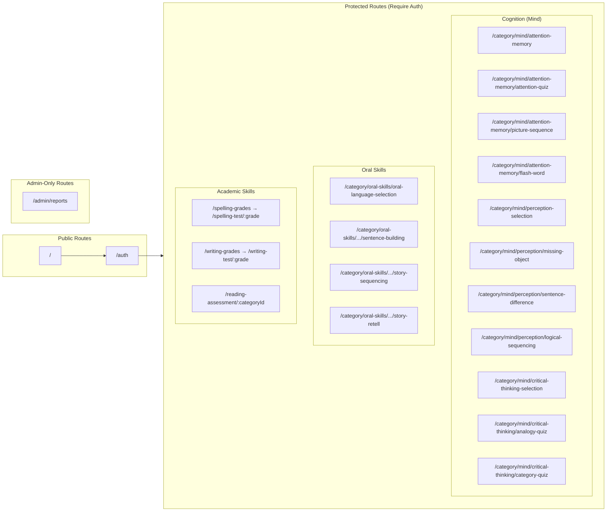

### 4.2 State Management

| Pattern | Usage |
|---------|-------|
| **React Context** | `AuthContext` — user session, profile, role, grade |
| **Component State** | Quiz game state (per-component `useState`) |
| **LocalStorage** | Progress tracking (per-user, via `ProgressTracker`) |
| **Supabase Auth** | Session stored in `sessionStorage` (allows multi-tab) |

### 4.3 Key Frontend Services

| Service | File | Responsibility |
|---------|------|---------------|
| `secureQuizService` | `services/secureQuizService.ts` | Fetch quiz content from backend API; submit answers for server-side grading |
| `geminiService` | `services/geminiService.ts` | Writing evaluation via backend AI proxy |
| `reportService` | `services/reportService.ts` | Generate PDF reports, trigger email delivery |
| `quizResultsService` | `services/quizResultsService.ts` | Save quiz results to backend database |
| `ProgressTracker` | `utils/progressTracker.ts` | Track cognition section completion (14 quizzes) |
| `EnhancedTTS` | `utils/enhancedTTS.ts` | Text-to-speech with voice quality selection |

---

## 5. Backend Architecture

### 5.1 Server Setup

The Express server (`backend/src/index.ts`) applies security-first middleware:

1. **Helmet** — HTTP security headers
2. **CORS** — Strict origin checking (localhost + production URLs)
3. **Rate Limiting** — 100 requests per 15 minutes per IP
4. **Body Parsing** — JSON + URL-encoded, 10 MB limit

### 5.2 API Route Modules

```mermaid
graph TD
    API["/api"]
    API --> Health["/health — Health Check"]
    API --> Profile["/profile — User Profile CRUD"]
    API --> Quizzes["/quizzes — Quiz Metadata"]
    API --> Results["/results — Save/Get Quiz Results"]
    API --> Progress["/progress — User Progress"]
    API --> Reports["/reports — PDF Generation + Email"]
    API --> Admin["/admin — User Mgmt, Analytics (Admin Only)"]
    API --> Teacher["/teacher — Student View (Teacher/Admin)"]
    API --> AI["/ai — Gemini AI (Writing Eval, Assessment Gen)"]
    API --> QuizContent["/quiz-content — Secure Quiz Delivery"]

    QuizContent --> Spelling["Spelling Sessions"]
    QuizContent --> Blending["Blending Quiz"]
    QuizContent --> Vocab["Vocabulary"]
    QuizContent --> StoryRetell["Story Retell"]
    QuizContent --> CritThink["Critical Thinking"]
    QuizContent --> LearnStyle["Learning Styles"]
    QuizContent --> LogicSeq["Logical Sequencing"]
    QuizContent --> Attention["Attention Control"]
    QuizContent --> Memory["Memory Assessment"]
    QuizContent --> SentDiff["Sentence Differences"]
    QuizContent --> StartEnd["Starting/Ending Sounds"]
    QuizContent --> Writing["Writing Prompts"]
```

### 5.3 Session Storage Architecture

Quiz sessions use a **dual-backend abstraction** (`lib/sessionStorage.ts`):

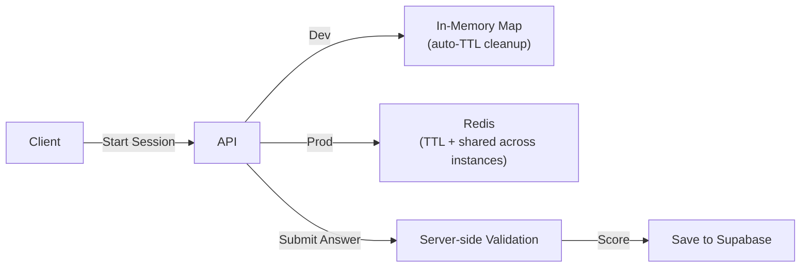

---

## 6. Database Schema

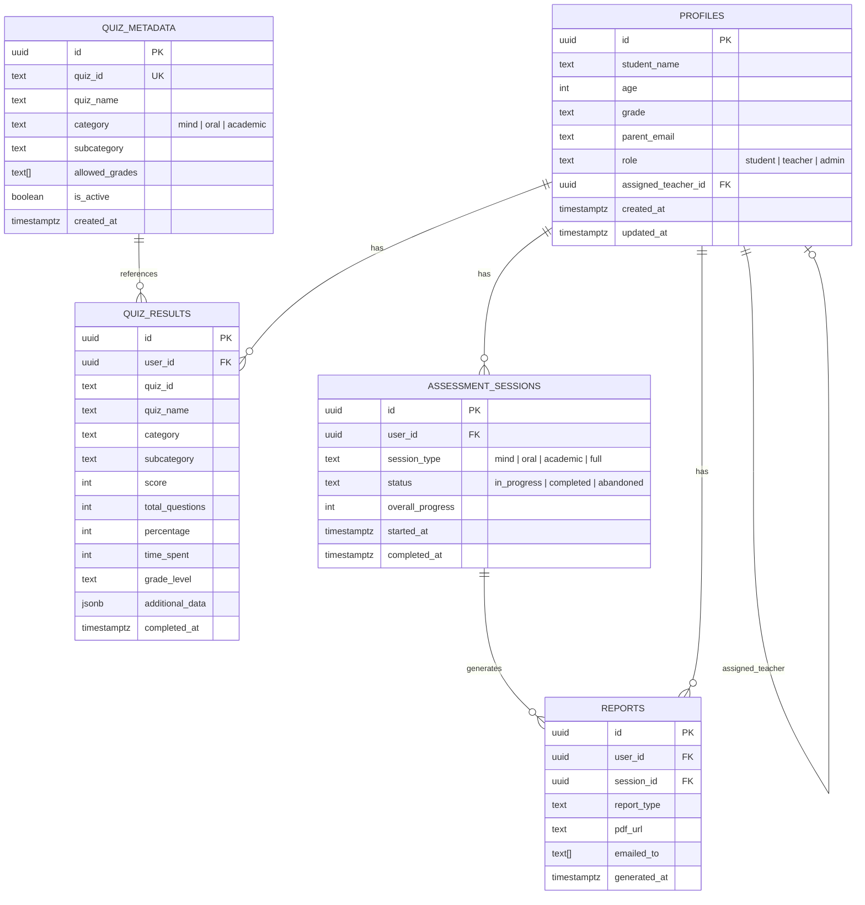

### Row-Level Security (RLS)

All tables have RLS enabled:

| Table | Students | Teachers | Admins |
|-------|----------|----------|--------|
| `profiles` | Own profile only | Assigned students | All profiles |
| `quiz_results` | Own results | Assigned student results | All results |
| `assessment_sessions` | Own sessions | — | All sessions |
| `reports` | Own reports | Assigned student reports | All reports |
| `quiz_metadata` | Active quizzes (read) | Active quizzes (read) | Full CRUD |

---

## 7. Authentication & Authorization

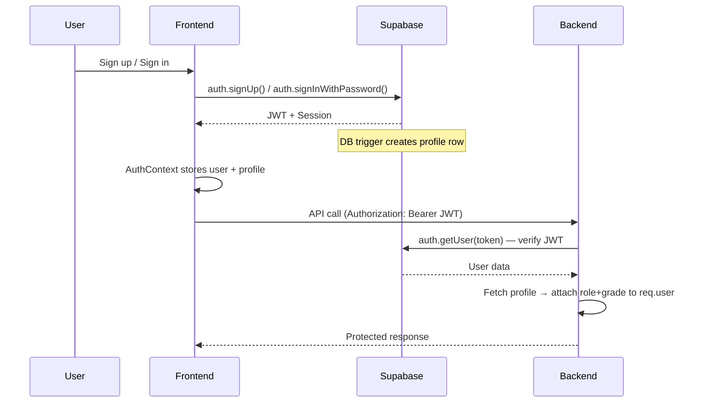

### Role Hierarchy

| Role | Access |
|------|--------|
| **Student** | Take quizzes (grade-restricted), view own results & reports |
| **Teacher** | View assigned students' results and reports |
| **Admin** | Full access — manage users, view all data, configure quizzes |

### Grade-Based Access Control

Quiz access is controlled by a rules engine (`utils/gradeUtils.ts` + `middleware/gradeAccess.ts`):

- **Cognition (Mind)**: Grades 1–5 only
- **Oral Skills**: Varies by sub-quiz (Grades 1–4 or 1–6)
- **Academic**: All grades (1–8), but students can only access their own grade level
- **Admin/Teacher**: Bypass all grade restrictions

---

## 8. Assessment Domains & Quiz Catalog

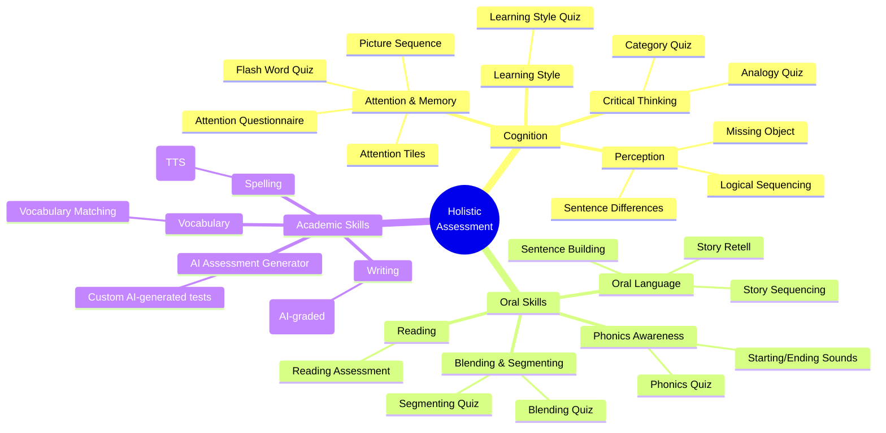

### Quiz Delivery Security Model

Quizzes use a **server-side scoring architecture**:

1. Frontend requests questions → Backend sends questions **without answers**
2. Student submits answers → Backend validates against stored answers
3. Backend calculates score → Returns result to frontend
4. Result saved to `quiz_results` table in Supabase

This prevents answer inspection via browser DevTools.

---

## 9. Key User Flows

### 9.1 Student Assessment Flow

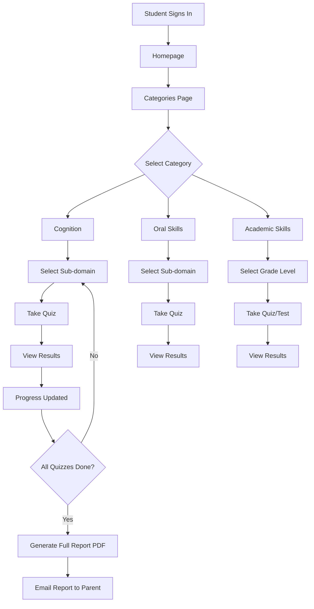

### 9.2 Report Generation Flow

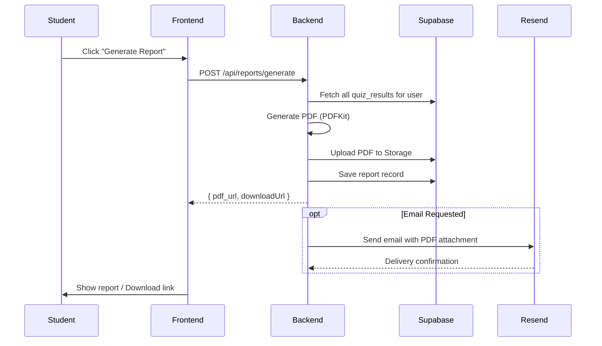

### 9.3 AI Writing Evaluation Flow

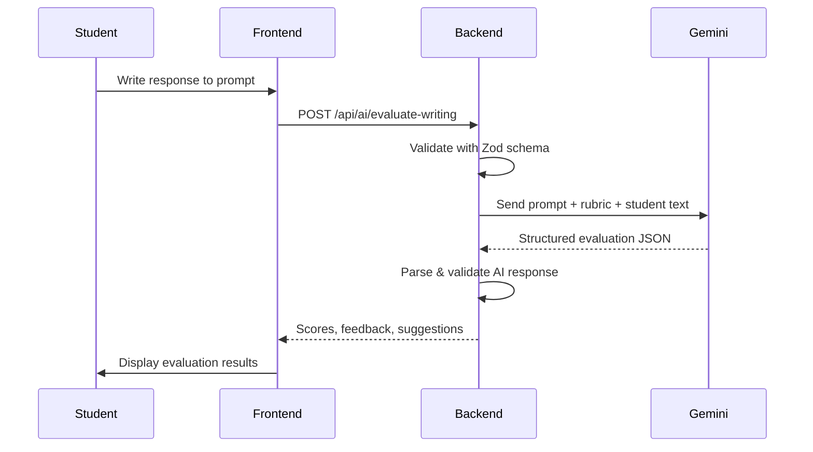

---

## 10. Deployment Architecture

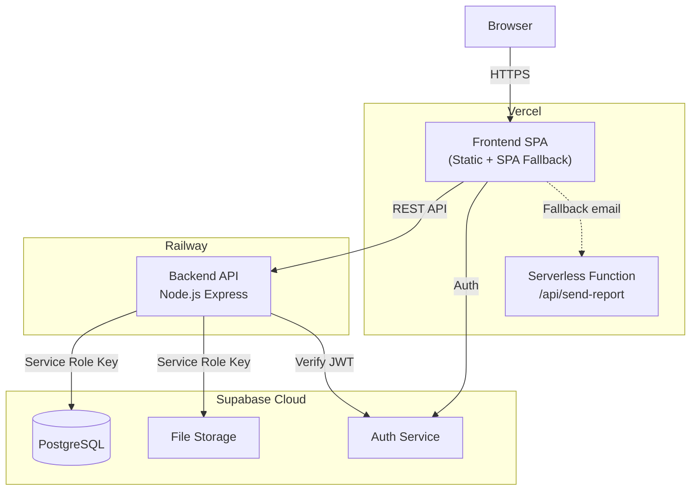

### Configuration

- **Vercel**: `vercel.json` — SPA rewrites, serverless function memory (1024 MB)
- **Railway**: `railway.json` + `Procfile` — `node dist/index.js`
- **Base Path**: `/holistic-assessment-tool` (GitHub Pages compatible)

---

## 11. Security Model

| Layer | Mechanism | Details |
|-------|-----------|---------|
| **Transport** | HTTPS | Enforced by Vercel/Railway |
| **Auth** | Supabase JWT | `sessionStorage`-based (multi-tab safe) |
| **API** | Bearer token verification | Every protected route verifies JWT via Supabase |
| **CORS** | Strict origin allowlist | Only `localhost:5173` + production URL |
| **Rate Limiting** | 100 req/15min per IP | `express-rate-limit` |
| **Headers** | Helmet | CSP, X-Frame-Options, HSTS, etc. |
| **Quiz Integrity** | Server-side answers | Answers never sent to client until post-submission |
| **Session Tracking** | Server-side session storage | Prevents replaying quiz answers |
| **Data Access** | PostgreSQL RLS | Row-level security on all tables |
| **Input Validation** | Zod schemas | All API inputs validated before processing |
| **Grade Access** | Rules engine | Students restricted to grade-appropriate quizzes |
| **Role Access** | Middleware guards | Admin/Teacher routes protected by role checks |

---

## 12. Developer Perspective — Code Quality & Maintainability

### Strengths

- **TypeScript throughout**: Both frontend and backend have type definitions, reducing runtime errors
- **Lazy loading**: All 49 pages use `React.lazy()` for code splitting — keeps initial bundle small
- **Zod validation**: Every backend endpoint validates input with Zod schemas
- **Consistent patterns**: Services follow a uniform `getAccessToken() → fetch() → handle error` pattern
- **Environment-based config**: All secrets via environment variables, never hardcoded
- **Error boundaries**: React `ErrorBoundary` wrapping prevents full-app crashes
- **Dual session storage**: Clean abstraction allowing in-memory (dev) to Redis (prod) switch

### Areas for Improvement

| Area | Current State | Recommendation |
|------|--------------|----------------|
| **Route duplication** | Some quizzes have duplicate routes (legacy + new paths) | Consolidate to canonical paths; add redirects for old ones |
| **Component size** | Some page components (e.g. AttentionQuiz, MemoryAssessment) exceed 500–600 lines | Extract quiz logic into custom hooks; split UI into sub-components |
| **Data co-location** | Frontend `src/data/` has quiz data that's also in `backend/src/data/` | Single source of truth on backend; remove frontend duplicates |
| **Error handling** | Frontend services silently fall back on failure | Add user-facing error toasts/banners |
| **Testing** | No test files found | Add unit tests (Vitest) and integration tests |
| **Strict TypeScript** | Backend has `strict: false`, `noImplicitAny: false` | Enable strict mode incrementally |
| **CSS verbosity** | Inline Tailwind classes can get very long | Extract common patterns into Tailwind `@apply` utilities |
| **Magic strings** | Quiz IDs, routes, and category names are strings throughout | Create shared enums/constants |

---

## 13. Architect Perspective — Scalability & Patterns

### Current Architecture Patterns

| Pattern | Implementation |
|---------|---------------|
| **SPA + REST API** | Decoupled frontend/backend with JWT auth |
| **BFF (Backend for Frontend)** | Backend acts as a BFF — proxies Gemini AI, handles scoring |
| **Repository pattern** | Supabase client acts as data access layer |
| **Strategy pattern** | Session storage (In-Memory vs. Redis) via interface |
| **Lazy loading** | Route-level code splitting |
| **Role-based access** | Middleware-based role + grade guards |

### Scalability Considerations

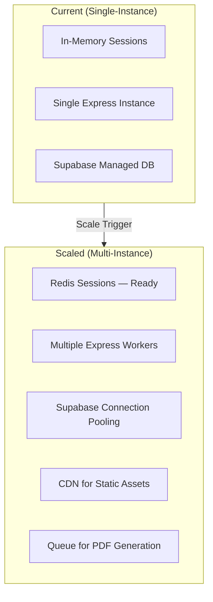

| Concern | Status | Path Forward |
|---------|--------|-------------|
| **Session state** | ✅ Redis-ready abstraction exists | Deploy Redis in production |
| **PDF generation** | ⚠️ Synchronous in request handler | Move to background job queue (BullMQ) |
| **AI calls** | ⚠️ Synchronous, can be slow | Add timeout + retry; consider async with webhooks |
| **Database** | ✅ Supabase-managed PostgreSQL | Built-in connection pooling via pgBouncer |
| **Static assets** | ⚠️ Served from same origin | Move to CDN (Vercel Edge handles this) |
| **Monitoring** | ❌ No observability layer | Add structured logging, error tracking (Sentry) |

---

## 14. Product Manager Perspective — Features & Roadmap

### Feature Inventory

| Feature | Status | Notes |
|---------|--------|-------|
| Student registration & auth | ✅ Complete | Email/password via Supabase |
| Multi-role system (Student/Teacher/Admin) | ✅ Complete | Role-based routing and API access |
| Cognition assessments (14 quizzes) | ✅ Complete | Attention, Memory, Learning Style, Critical Thinking, Perception |
| Oral skills assessments | ✅ Complete | Sentence building, Story sequencing/retell, Reading, Phonics, Blending |
| Academic assessments | ✅ Complete | Spelling (TTS), Writing (AI-graded), Vocabulary matching |
| AI assessment generator | ✅ Complete | Custom test generation via Gemini |
| Grade-based access control | ✅ Complete | Students see only age-appropriate content |
| Progress tracking | ✅ Complete | Per-user progress bar for cognition section |
| PDF report generation | ✅ Complete | Server-side PDF with scores, recommendations |
| Email report delivery | ✅ Complete | PDF attachment via Resend |
| Admin dashboard | ✅ Complete | User management, report viewing, analytics |
| Teacher dashboard | ✅ Complete | Assigned student view |
| Drag-and-drop interactions | ✅ Complete | @dnd-kit for sorting quizzes |
| Animated UI | ✅ Complete | Framer Motion throughout |
| Bilingual support | 🟡 Partial | Arabic language toggle exists in Oral Language quiz |
| Mobile responsiveness | 🟡 Partial | Tailwind responsive classes used, not fully audited |
| Offline support | ❌ Not started | No service worker or PWA manifest |
| Analytics dashboard | 🟡 Basic | Admin can view reports; no aggregate analytics |
| Parent portal | ❌ Not started | Parents receive email but have no login |
| Accessibility (WCAG) | 🟡 Partial | Some ARIA patterns; needs audit |

### User Personas & Value Proposition

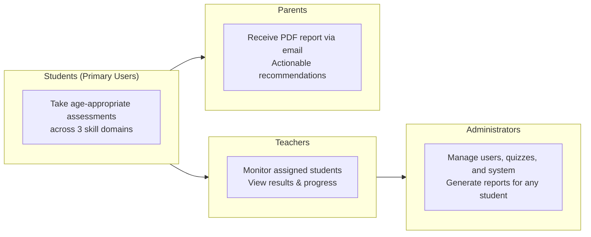

### Suggested Product Roadmap

| Priority | Feature | Impact | Effort |
|----------|---------|--------|--------|
| 🔴 High | Automated test suite | Prevents regressions (routes have broken before) | Medium |
| 🔴 High | Error monitoring (Sentry) | Catch production issues early | Low |
| 🟡 Medium | Parent portal | Parents can track progress directly | High |
| 🟡 Medium | Aggregate analytics dashboard | Teachers see class-level trends | Medium |
| 🟡 Medium | Full mobile audit + PWA | Broader device support | Medium |
| 🟡 Medium | Full WCAG accessibility audit | Inclusivity & compliance | Medium |
| 🟢 Low | Full bilingual support (Arabic) | Broader user base | High |
| 🟢 Low | Gamification (badges, streaks) | Student engagement | Medium |
| 🟢 Low | Offline quiz support | Use in low-connectivity environments | High |

---

## 15. Environment Variables

### Frontend (`.env`)

| Variable | Description |
|----------|-------------|
| `VITE_SUPABASE_URL` | Supabase project URL |
| `VITE_SUPABASE_ANON_KEY` | Supabase anonymous public key |
| `VITE_API_URL` | Backend API base URL (default: `http://localhost:3001`) |
| `VITE_BASE_PATH` | SPA base path (default: `/holistic-assessment-tool`) |

### Backend (`.env`)

| Variable | Description |
|----------|-------------|
| `PORT` | Server port (default: `3001`) |
| `SUPABASE_URL` | Supabase project URL |
| `SUPABASE_SERVICE_KEY` | Supabase service role key (admin) |
| `SUPABASE_ANON_KEY` | Supabase anonymous key |
| `GEMINI_API_KEY` | Google Gemini AI API key |
| `RESEND_API_KEY` | Resend email API key |
| `FRONTEND_URL` | Frontend origin for CORS |
| `REDIS_URL` | Redis connection string (production) |
| `NODE_ENV` | `development` or `production` |

---

## 16. Getting Started

### Prerequisites

- Node.js >= 20
- npm or yarn
- Supabase project (with schema applied)
- Google Gemini API key (for AI features)
- Resend API key (for email features)

### Setup

```bash
# 1. Clone the repository
git clone https://github.com/YOUR_USERNAME/holistic-assessment-tool.git
cd holistic-assessment-tool

# 2. Install frontend dependencies
npm install

# 3. Install backend dependencies
cd backend && npm install && cd ..

# 4. Configure environment variables
cp .env.example .env          # Frontend
cp backend/.env.example backend/.env  # Backend

# 5. Apply database schema
# Run backend/scripts/schema.sql in Supabase SQL Editor

# 6. Seed quiz metadata
cd backend && npm run seed && cd ..

# 7. Start development servers
npm run dev          # Frontend → http://localhost:5173
cd backend && npm run dev  # Backend → http://localhost:3001
```

---

## 17. Open Questions & Actionable Insights

### Architecture Decisions to Revisit

1. **Duplicate data layers**: Frontend `src/data/` contains quiz data that also lives in `backend/src/data/`. Which is the source of truth? Consider eliminating the frontend copies entirely and serving all quiz content via the API.

2. **Three server entrypoints**: There are three separate server implementations — `backend/` (main Express API), `server/` (legacy email server), and `api/send-report.js` (Vercel serverless). Consolidate into the main backend to reduce maintenance surface.

3. **Route explosion**: 55 routes with many following identical patterns (motion wrapper). Consider a route configuration array mapped to components, which would reduce App.tsx from 822 lines to ~100.

4. **Progress tracking scope**: The `ProgressTracker` currently only tracks the Cognition (Mind) section. Should Oral Skills and Academic Skills also have progress tracking and section reports?

### Questions for Product Stakeholders

- **Target user scale**: How many concurrent students are expected? This impacts whether Redis is needed immediately.
- **Offline requirements**: Will this be used in schools with unreliable internet? This drives PWA investment.
- **Curriculum alignment**: Are the quiz questions mapped to specific national/regional curricula? This affects content governance.
- **Data retention**: How long should quiz results be stored? Are there educational data privacy regulations (FERPA, GDPR) to comply with?
- **Multi-tenancy**: Will multiple schools use the same instance, or will each school have a separate deployment?

---

*Platform: Holistic Assessment Tool*
