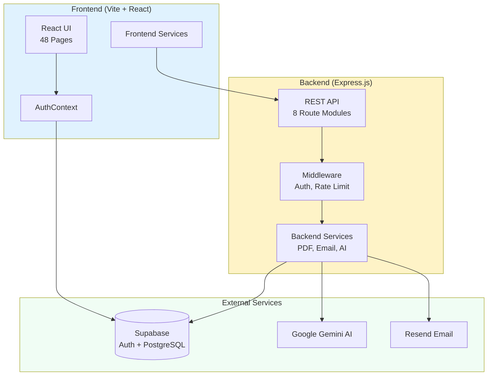
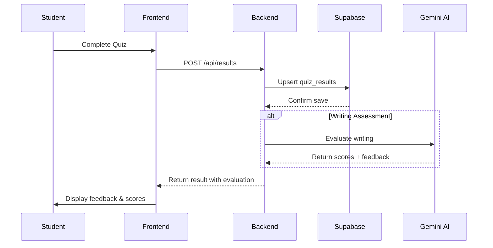
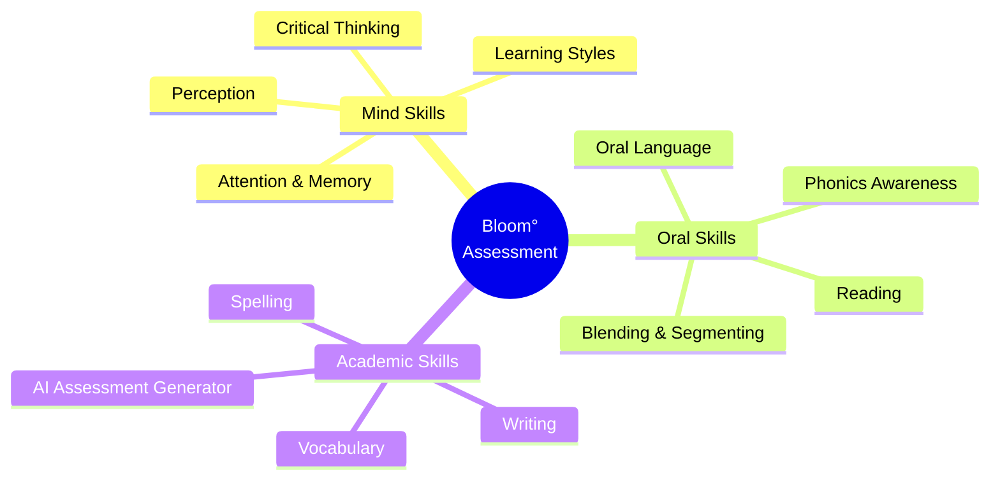
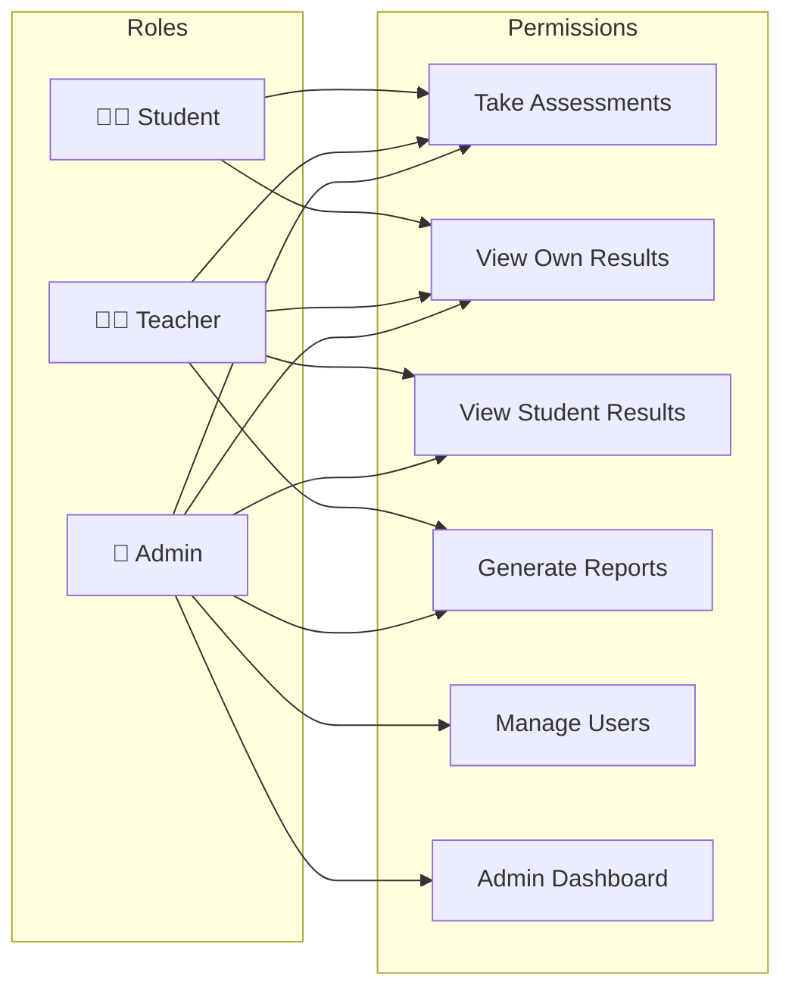
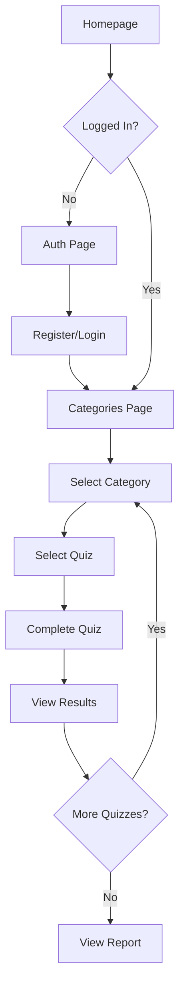
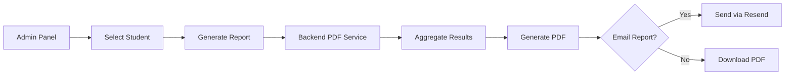

# Bloom° Holistic Assessment Tool

> **Educational Assessment Platform for Ages 6-12**  
> Comprehensive cognitive skills evaluation covering Mind, Oral, and Academic abilities

---

## Table of Contents

- [Overview](#overview)
- [System Architecture](#system-architecture)
- [Technology Stack](#technology-stack)
- [Feature Inventory](#feature-inventory)
- [Code Organization](#code-organization)
- [User Flows](#user-flows)
- [Key Insights & Analysis](#key-insights--analysis)
- [Actionable Recommendations](#actionable-recommendations)

---

## Overview

Bloom° is a holistic educational assessment platform designed for students aged 6-12 (Grades 1-8). The platform evaluates cognitive, oral, and academic skills through interactive quizzes and assessments, providing detailed reports with actionable recommendations for parents and educators.

### Key Value Propositions

| Feature | Description |
|---------|-------------|
| **Comprehensive Assessment** | 3 categories, 12+ skill areas, 30+ individual quizzes |
| **AI-Powered Evaluation** | Gemini AI for writing assessment and custom test generation |
| **Grade-Specific Rubrics** | Tailored evaluation criteria for each grade level (1-8) |
| **Detailed Reporting** | PDF reports with scores, strengths, and recommendations |
| **Role-Based Access** | Student, Teacher, and Admin roles with appropriate permissions |

---

## System Architecture



### Data Flow for Quiz Completion



---

## Technology Stack

### Frontend

| Technology | Purpose | Version |
|------------|---------|---------|
| **React** | UI Framework | 18.3.1 |
| **Vite** | Build Tool | 5.4.2 |
| **TypeScript** | Type Safety | 5.5.3 |
| **TailwindCSS** | Styling | 3.4.1 |
| **Framer Motion** | Animations | 12.23.9 |
| **React Router** | Navigation | 7.7.0 |
| **@dnd-kit** | Drag and Drop | 6.3.1 |
| **@react-pdf/renderer** | PDF Generation (client) | 4.3.1 |

### Backend

| Technology | Purpose | Version |
|------------|---------|---------|
| **Express.js** | API Server | 4.21.0 |
| **TypeScript** | Type Safety | 5.5.4 |
| **Zod** | Request Validation | 3.23.8 |
| **Helmet** | Security Headers | 7.1.0 |
| **express-rate-limit** | Rate Limiting | 7.4.1 |
| **PDFKit** | PDF Generation | 0.15.0 |
| **Resend** | Email Service | 4.0.0 |

### External Services

| Service | Purpose |
|---------|---------|
| **Supabase** | Authentication, PostgreSQL Database, Storage |
| **Google Gemini AI** | Writing evaluation, Assessment generation |
| **Railway** | Backend hosting |
| **Vercel** | Frontend hosting |

---

## Feature Inventory

### Assessment Categories



### Quiz Types by Category

| Category | Subcategory | Quizzes |
|----------|-------------|---------|
| **Mind** | Attention/Memory | Attention Assessment, Memory Assessment, Attention Quiz |
| | Learning Style | Learning Styles Quiz (VARK) |
| | Critical Thinking | Analogy Quiz, Category Quiz |
| | Perception | Perception Quiz, Missing Object, Sentence Difference, Spot the Difference |
| **Oral** | Oral Language | Oral Language Quiz, Story Retell |
| | Reading | Reading Assessment, Flash Word Quiz |
| | Phonics | Phonics Quiz, Starting/Ending Sound |
| | Blending | Blending Quiz, Segmenting Quiz |
| **Academic** | Writing | Writing Test (AI-evaluated) |
| | Vocabulary | Vocabulary Matching |
| | Spelling | Spelling Test |
| | AI Tools | Assessment Generator |

### User Roles & Permissions



---

## Code Organization

### Frontend Structure (`/src`)

```
src/
├── App.tsx                    # Main app with lazy-loaded routes
├── main.tsx                   # Entry point
├── index.css                  # Global styles
├── supabase-client.ts         # Supabase client + API functions
│
├── components/                # 24 reusable components
│   ├── ErrorBoundary.tsx      # Error handling
│   ├── LoadingSpinner.tsx     # Loading states
│   ├── ProtectedRoute.tsx     # Route protection
│   ├── NavigationBar.tsx      # App navigation
│   ├── ResultScreen.tsx       # Quiz results display
│   ├── ReportPDF.tsx          # Client-side PDF
│   └── games/                 # Interactive game components
│
├── pages/                     # 48 page components
│   ├── Homepage.tsx           # Landing page
│   ├── AuthPage.tsx           # Login/Register
│   ├── CategoriesPage.tsx     # Assessment categories
│   ├── AdminReports.tsx       # Admin dashboard
│   └── [Quiz]*.tsx            # Individual quiz pages
│
├── contexts/                  # React contexts
│   └── AuthContext.tsx        # Authentication state
│
├── services/                  # API services
│   ├── geminiService.ts       # AI API calls
│   ├── quizResultsService.ts  # Results API
│   └── reportService.ts       # Report generation
│
├── data/                      # Static quiz content
│   ├── assessmentData.ts      # Category structure
│   ├── spellingData.ts        # Spelling words by grade
│   ├── writingData.ts         # Writing prompts
│   └── [quiz]Data.ts          # Quiz-specific content
│
├── utils/                     # Utility functions
│   ├── logger.ts              # Logging wrapper
│   ├── gradeUtils.ts          # Grade helpers
│   ├── enhancedTTS.ts         # Text-to-speech
│   └── progressTracker.ts     # Progress tracking
│
└── types/
    ├── index.ts               # Frontend types
    └── database.ts            # Database types
```

### Backend Structure (`/backend/src`)

```
backend/src/
├── index.ts                   # Express server entry
│
├── routes/                    # 8 route modules
│   ├── admin.ts               # Admin endpoints
│   ├── ai.ts                  # AI evaluation endpoints
│   ├── profile.ts             # User profile CRUD
│   ├── progress.ts            # Progress tracking
│   ├── quizzes.ts             # Quiz metadata
│   ├── reports.ts             # Report generation
│   ├── results.ts             # Quiz results
│   └── teacher.ts             # Teacher endpoints
│
├── middleware/
│   ├── auth.ts                # JWT verification
│   └── gradeAccess.ts         # Grade-based access control
│
├── services/
│   ├── emailService.ts        # Resend email
│   ├── pdfGenerator.ts        # PDFKit reports
│   └── storageService.ts      # Supabase storage
│
├── config/
│   └── supabase.ts            # Supabase admin client
│
└── types/
    └── database.ts            # Database types
```

---

## User Flows

### Student Assessment Flow



### Report Generation Flow



---

## Key Insights & Analysis

### 🏗️ Software Architect Perspective

| Aspect | Rating | Analysis |
|--------|--------|----------|
| **Scalability** | 7/10 | Stateless backend enables horizontal scaling. Consider caching for quiz data. |
| **Security** | 8/10 | JWT auth, Helmet, rate limiting, RLS in Supabase. API keys properly server-side. |
| **Separation of Concerns** | 7/10 | Clear frontend/backend split. Some pages are too large (30KB+). |
| **Database Design** | 8/10 | Good normalized schema with proper foreign keys and RLS policies. |
| **API Design** | 7/10 | RESTful patterns, Zod validation. Missing API versioning. |

**Architecture Strengths:**
- Clean separation between frontend and backend
- Supabase handles auth, database, and storage in one platform
- AI processing offloaded to Gemini API
- Session storage prevents multi-user conflicts

**Architecture Concerns:**
- No caching layer for frequently accessed quiz data
- Large monolithic pages instead of micro-frontends
- Missing API versioning (`/api/v1/`)

### 💻 Software Developer Perspective

| Aspect | Rating | Analysis |
|--------|--------|----------|
| **Code Organization** | 7/10 | Good folder structure, but 48 pages in one folder is unwieldy |
| **Type Safety** | 8/10 | Comprehensive types, shared between FE/BE |
| **Error Handling** | 7/10 | ErrorBoundary added, fallback patterns in services |
| **Code Splitting** | 8/10 | React.lazy() for all pages (recently implemented) |
| **Testing** | 2/10 | No test files found - significant gap |
| **Documentation** | 5/10 | Inline comments exist, missing API documentation |

**Developer Experience Wins:**
- TypeScript throughout the stack
- Zod validation provides runtime type checking
- Logger abstraction prevents console.log pollution
- Clear naming conventions

**Technical Debt Identified:**
- No automated tests
- Some page files exceed 30KB (ReadingAssessment, AuthPage)
- Quiz data hardcoded in frontend (should be in database)
- Duplicate type definitions (now synced)

### 📊 Product Manager Perspective

| Aspect | Rating | Analysis |
|--------|--------|----------|
| **Feature Completeness** | 8/10 | 30+ quizzes covering 3 major cognitive areas |
| **User Experience** | 8/10 | Kid-friendly design, engaging animations, clear feedback |
| **Value Proposition** | 9/10 | Unique comprehensive assessment with AI evaluation |
| **Onboarding** | 6/10 | Registration works but no guided tour |
| **Analytics** | 4/10 | Progress tracking exists but no business analytics |
| **Accessibility** | 5/10 | Basic support, needs improvement for screen readers |

**Product Strengths:**
- Clear target audience (ages 6-12)
- AI-powered writing evaluation is differentiating
- PDF reports provide tangible value for parents
- Grade-specific rubrics ensure age-appropriate assessment

**Product Opportunities:**
- Add onboarding tutorial for first-time users
- Implement gamification (badges, streaks, leaderboards)
- Add parent portal for viewing child progress
- Mobile app for offline assessment

---

## Actionable Recommendations

### 🔴 Critical Priority (Week 1)

| # | Recommendation | Impact | Effort |
|---|----------------|--------|--------|
| 1 | **Add automated tests** - At minimum, unit tests for services and integration tests for API routes | High | Medium |
| 2 | **Add API versioning** - Prefix all routes with `/api/v1/` to enable future breaking changes | Medium | Low |
| 3 | **Implement request logging** - Add structured logging for debugging and monitoring | Medium | Low |

### 🟡 High Priority (Month 1)

| # | Recommendation | Impact | Effort |
|---|----------------|--------|--------|
| 4 | **Refactor large page components** - Split AuthPage (36KB), ReadingAssessment (37KB) into smaller components | Medium | Medium |
| 5 | **Add caching layer** - Redis or in-memory cache for quiz data and metadata | High | Medium |
| 6 | **Move quiz data to database** - Store quiz content in Supabase instead of hardcoded files | Medium | High |
| 7 | **Improve accessibility** - Add ARIA labels, keyboard navigation, screen reader support | Medium | Medium |

### 🟢 Future Enhancements

| # | Recommendation | Business Value |
|---|----------------|----------------|
| 8 | **Mobile app** - React Native app for offline-first assessment | Expands market reach |
| 9 | **Parent dashboard** - Dedicated view for parents to track child progress | Increases engagement |
| 10 | **Gamification** - Badges, achievements, progress streaks | Improves retention |
| 11 | **Teacher dashboard** - Class-wide analytics and progress comparison | Enables school sales |
| 12 | **Multi-language support** - i18n for content and UI | International expansion |

---

## Questions for Further Development

1. **What is the target deployment scale?** - This affects caching and database strategy
2. **Are there plans for school/district licensing?** - Impacts multi-tenancy architecture
3. **Is offline support required?** - Would require service worker implementation
4. **What analytics are needed for business decisions?** - May need event tracking (Mixpanel, Amplitude)
5. **Are there COPPA/FERPA compliance requirements?** - May need additional data handling procedures

---

## Quick Start

### Prerequisites
- Node.js >= 20.0.0
- npm or yarn
- Supabase account

### Frontend Development
```bash
cd holistic-assessment-tool
npm install
npm run dev
# Available at http://localhost:5173
```

### Backend Development
```bash
cd backend
npm install
npm run dev
# Available at http://localhost:3001
```

### Environment Variables

**Frontend (`.env`):**
```env
VITE_SUPABASE_URL=https://your-project.supabase.co
VITE_SUPABASE_ANON_KEY=your-anon-key
VITE_API_URL=http://localhost:3001
VITE_BASE_PATH=/holistic-assessment-tool
```

**Backend (`.env`):**
```env
SUPABASE_URL=https://your-project.supabase.co
SUPABASE_SERVICE_KEY=your-service-key
GEMINI_API_KEY=your-gemini-key
RESEND_API_KEY=your-resend-key
FRONTEND_URL=http://localhost:5173
```

---

*Generated: January 2026*  
*Platform: Bloom° by Holistic Assessment Tool*
